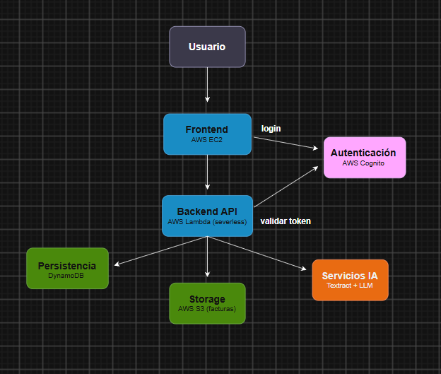

# ☁️ Medianube

**SaaS Integral de Gestión Gastronómica Inteligente**

Proyecto desarrollado por: Amado Lautaro, Cáceres Juan, Figueira Julián, Piquet Leonel y Tundis Yamil.

## 📌 Sobre el Proyecto
Medianube es una solución integral en formato SaaS diseñada para dueños, administradores y encargados de producción en negocios gastronómicos. El sistema automatiza el día a día mediante Inteligencia Artificial: gestiona las compras analizando automáticamente las facturas, sugiere precios de venta para proteger la rentabilidad frente a la inflación y predice la demanda futura de producción.

*Para más detalles sobre el análisis del problema y nuestra propuesta inicial, consultar el [One-Pager](docs/ONE-PAGER.md).*

## 🛠️ Arquitectura y Stack Tecnológico
El sistema está diseñado bajo un modelo Cloud-Native en AWS (`us-east-2`):
- **Frontend:** **Next.js 15 / React + TypeScript**, desplegado en **AWS EC2** detrás de Nginx y PM2 (ver [ADR](docs/FRONTEND-DEPLOYMENT.md) y [guía de redespliegue](docs/REDESPLEGAR.md)).
- **Capa de Red y Edge Caching:** **Amazon API Gateway** (HTTP API `1i2vqeifsi` con Authorizer JWT de Cognito en rutas protegidas) y **Amazon CloudFront** (`d2nm15i6i0na2r.cloudfront.net`) para cachear lecturas de `/clima` y `/demanda` con una mejora de ~10× en latencia (ver [ADR](docs/EDGE-CACHING.md)).
- **Backend (Serverless):** **AWS Lambda** (Node.js 22+) con arquitectura hexagonal en TypeScript en [`backend/`](backend/README.md) y funciones operativas versionadas en [`backend/lambdas-consola/`](backend/lambdas-consola/README.md) (ver [ADR](docs/BACKEND-ARCHITECTURE.md) y [despliegue manual](docs/DESPLIEGUE-MANUAL.md)).
- **Mensajería y Automatización:** **Amazon SQS** (`medianube-facturas-queue`) para *Load Leveling* entre S3 y el procesamiento OCR, y **Amazon EventBridge** para corridas diarias automáticas (refresco de clima a las 05:00 ART y predicción de demanda a las 05:30 ART).
- **Base de Datos:** **Amazon DynamoDB On-Demand** (ver [ADR](docs/DATABASE-DECISION.md)).
- **Storage:** **Amazon S3** con *Pre-signed URLs* para carga y descarga segura de facturas y reportes PDF.
- **Autenticación:** **AWS Cognito** (User Pool + tokens JWT validados en API Gateway y middleware de Next.js).
- **Datos externos:** **Open-Meteo** (pronóstico de 7 días con caché en DynamoDB).
- **IA y Modelos:**
  - **Google Gemini:** extracción estructurada de facturas (OCR en `procesarFactura`) y motor oficial de precios sugeridos (`sugerirPrecios-dev`, con respaldo determinístico por reglas ante fallas del LLM; ver [ADR](docs/MOTOR-PRECIOS-DECISION.md)).
  - **Modelo estadístico propio (`demanda-v1`):** predicción nocturna de demanda a 7 días combinando historial semanal de ventas y factor de lluvia (ver [ADR](docs/PREDICCION-DEMANDA.md)).

## 📚 Documentación y ADRs
- **Producto y UX/UI:** [One-Pager](docs/ONE-PAGER.md) · [Design System](docs/UXUI/DESIGN.md) · [Plan de mejora UX/UI](docs/UXUI/plan-mejora/PLAN-MEJORA-UX-UI.md)
- **Decisiones de Arquitectura (ADRs):**
  - [Descarte de Docker vs Serverless](docs/DOCKER-VS-SERVERLESS.md)
  - [Despliegue del Frontend (EC2 vs PaaS)](docs/FRONTEND-DEPLOYMENT.md)
  - [Arquitectura Hexagonal del Backend](docs/BACKEND-ARCHITECTURE.md)
  - [Base de Datos (DynamoDB vs RDS)](docs/DATABASE-DECISION.md)
  - [Motor de Precios Oficial (Gemini vs Claude)](docs/MOTOR-PRECIOS-DECISION.md) · [Diseño original](docs/MOTOR-PRECIOS.md)
  - [Predicción de Demanda Nocturna](docs/PREDICCION-DEMANDA.md)
  - [Manejo de Errores y Degradación Elegante](docs/MANEJO-ERRORES.md)
  - [Edge Caching con CloudFront](docs/EDGE-CACHING.md)
- **Operación y Despliegue:** [Despliegue manual en AWS](docs/DESPLIEGUE-MANUAL.md) · [Guía de integración de Clima y Demanda](docs/INTEGRACION-CLIMA.md) · [Cómo redesplegar Frontend en EC2](docs/REDESPLEGAR.md) · [Setup local Frontend](frontend/README.md) · [Backend y scripts](backend/README.md)
- **Auditoría de IA:** [Registro de Decisiones de IA (`AI-DECISIONS.md`)](AI-DECISIONS.md)

## 🧪 Pruebas Automatizadas
- **Backend:** `cd backend && npm test` (190 tests unitarios sobre dominio, casos de uso, adaptadores y Lambdas de consola).
- **Frontend:** `cd frontend && npm test` (36 tests unitarios de lógica de negocio, API y formateo) + `npm run lint` + `npm run build`.
- **Estrés SQS:** `backend/scripts/stress-test-sqs.mjs` (15 subidas concurrentes a S3 encoladas hacia `procesarFactura`).

---

## ⚠️ Workflow y Reglas de Desarrollo (Higiene de Ingeniería)

Para garantizar la calidad técnica y cumplir con los criterios de evaluación de la UTN FRLP, este equipo adopta el siguiente flujo de trabajo:

### 1. Control de Versiones (Conventional Commits)
La evaluación de la materia es individual y se auditará la frecuencia y calidad en el historial de Git. Es obligatorio el uso del estándar *Conventional Commits*:
- `feat:` Para nuevas funcionalidades (ej. `feat: agrega formulario de login`).
- `fix:` Para corrección de errores (ej. `fix: error de conexion con dynamoDB`).
- `docs:` Para actualizaciones de documentación (ej. `docs: actualiza diagrama cloud`).
- `chore:` / `refactor:` Para tareas de mantenimiento o refactorización.
- *Nota estricta:* Se prohíben los "code drops" (subidas masivas de código a último momento).

### 2. Integración y Revisiones de Código
- La rama `main` se encuentra protegida. Está prohibido el push directo.
- Todo aporte debe integrarse mediante **Pull Requests**.
- Es obligatoria la revisión cruzada (Code Review) entre los integrantes antes de aprobar y fusionar el código.

### 3. Gestión de Tareas (Kanban)
- La planificación se ejecuta de forma transparente en GitHub Projects.
- Para prevenir cuellos de botella operativos, el equipo debe respetar un límite de **[WIP: 4]** en la columna de tareas en curso.
- **Convención de Tareas:** Todo ticket debe crearse utilizando el formato `[Módulo] Acción a realizar` (ej. `[Infra] Crear instancia EC2`) y tener siempre un responsable asignado ("Assignee").

### 4. Auditoría de Inteligencia Artificial (AI Policy)
El uso de asistentes está permitido, pero es nuestra responsabilidad determinar qué está bien y qué está mal, qué sirve y qué no.
- Todo fragmento de código, arquitectura o prompt generado con IA se registra en [`AI-DECISIONS.md`](AI-DECISIONS.md).
- Cada entrada justifica: el problema abordado, la herramienta empleada, la salida generada y la corrección manual aplicada.

### 5. Entregas y Releases
El código correspondiente a cada Checkpoint evaluativo se congela mediante Tags de Git y ramas específicas para facilitar la auditoría de la cátedra:
- **Checkpoint 1 (28/09):** Tag `v0.1-checkpoint-1` (Rama: `entrega/checkpoint-1`).
- **Checkpoint 2 (09/11):** Tag `v0.2-checkpoint-2` (Rama: `entrega/checkpoint-2`).
- **Defensa Final (30/11):** Tag `v1.0-entrega-final` (Rama: `entrega/final`).

### 6. Convenciones de Arquitectura y Base de Datos
- **DynamoDB (Partition Keys):** Para garantizar la consistencia en todo el ecosistema Serverless y evitar deuda técnica al cruzar datos con los modelos de IA, el estándar para las tablas multi-usuario es utilizar `usuarioID` (String) como clave de partición (`sub` de Cognito en rutas autenticadas). Quedan prohibidas variantes locales como `userId` o `id_usuario`.